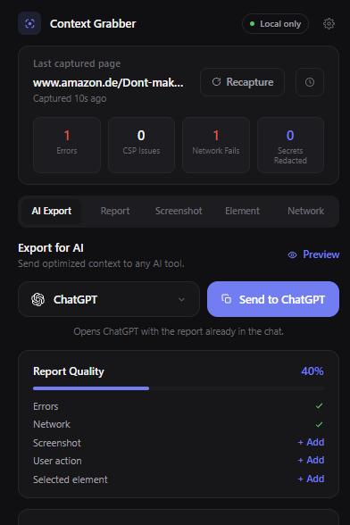
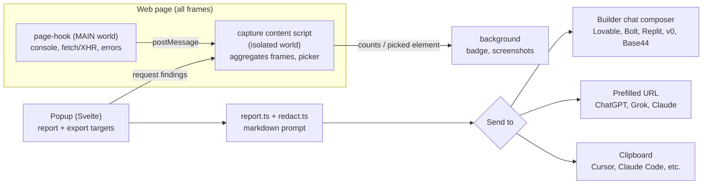

<div align="center">

# Context Grabber

**One-click bug reports for AI coding: capture what actually broke and send it straight into the AI you're using.**




</div>

---

## About

When an AI-built app breaks, typing "it doesn't work" into the chat forces the AI to guess. Context Grabber is a browser extension that captures what really went wrong (console errors, failed requests, broken assets, the element you're pointing at) and drops a structured, AI-ready report directly into the chat of Lovable, Bolt, Replit, v0 or Base44, or opens Claude/ChatGPT/Grok with it prefilled. Everything runs **locally** in the browser: no servers, no telemetry, no account.

## Features

- **Automatic capture** on every page, including inside iframes (e.g. Lovable/Bolt previews): console errors and warnings, uncaught exceptions, unhandled promise rejections, failed `fetch`/XHR requests, broken images/scripts/stylesheets and CSP-blocked requests. A badge shows the live error count per tab.
- **Send to Builder**: on a Lovable, Bolt.new, Replit, v0 or Base44 project page, one click writes the report into the builder's own chat composer (no auto-submit, you review and send). Claude, ChatGPT and Grok open with the report prefilled; other tools (Claude Code, Codex CLI, Cursor, Windsurf, Gemini, GitHub) get a formatted copy.
- **App vs. editor separation**: on builder pages the report splits "your app" (the preview iframe) from the builder's own editor-shell noise, so the AI chases your bug, not the platform's background chatter.
- **Noise filtering**: requests to ~35 known ad/analytics endpoints are classified as harmless, known-benign console messages (e.g. `ResizeObserver loop`, React Router future-flag notices) are filtered, and duplicates are collapsed.
- **Element picker**: click the broken part of the page to add its selector, HTML and key computed styles to the report. Optional page or region screenshot.
- **Always-on redaction**: API keys, GitHub/AWS/Google tokens, JWTs, bearer tokens and `password=...`-style values are replaced with `[REDACTED]` before anything is copied.
- **Zero page interference**: capture hooks preserve native `toString`, `name` and arity; picker UI lives in a closed shadow DOM on a pointer-transparent host; every hook is wrapped in try/catch and passes through to the original.
- **Polished UX**: light and dark mode, plus a first-run onboarding page with an intentional demo bug.

## Tech stack

| Area | Technology |
| --- | --- |
| Extension framework | [WXT](https://wxt.dev): Manifest V3, Chrome + Firefox/Edge from one codebase |
| Language | TypeScript |
| UI | Svelte 5 (popup + onboarding) |
| Styling | Tailwind CSS v4 |
| Icons | simple-icons |
| Licensing (optional Pro) | Lemon Squeezy public License API |
| Landing / privacy pages | Static HTML in `site/`, deployable via GitHub Actions (Pages) or Netlify |

## Architecture



| File | Role |
| --- | --- |
| `utils/page-hook.ts` | Self-contained page-world capture hook. Injected as an inline script, with a MAIN-world content-script fallback for CSP-strict pages; guarded to install exactly once. |
| `entrypoints/injected.content.ts` | MAIN-world fallback that runs the hook when inline injection is CSP-blocked. |
| `entrypoints/capture.content.ts` | Isolated-world companion (all frames): injects the hook, aggregates findings from child iframes (stamping each entry's frame `origin`), answers the popup, updates the badge, relays composer injection, element picker and region select. |
| `entrypoints/background.ts` | Badge updates, stores picked elements per tab, region-screenshot capture, opens onboarding on install. |
| `entrypoints/popup/` | Main UI: status hero, AI Export / Report / Screenshot / Element / Network tabs, send-to targets, Pro settings. |
| `entrypoints/onboarding/` | First-run demo page with an intentional bug (provides capture services itself, since extension pages can't run content scripts). |
| `utils/report.ts` | Builds the markdown prompt; on builder pages splits "your app" from "builder editor background". |
| `utils/builders.ts` | Registry of AI app-builder hosts and the shared app-vs-editor predicate (`isEditorOrigin`). |
| `utils/composer-inject.ts` | Finds a builder's chat composer (site-specific selectors + generic fallback) and fills it React-safely. |
| `utils/export-targets.ts` | "Send to" target system: inject targets, prefill URLs, per-target task text, Pro formats (client summary, developer hand-off). |
| `utils/license.ts` | Optional Pro licensing via Lemon Squeezy (activate + periodic validate; offline keeps Pro). |
| `utils/redact.ts` | Always-on secret redaction. |
| `utils/trackers.ts` | Known ad/analytics endpoints and benign console patterns. |
| `utils/types.ts` | Shared capture/report types. |

## Getting started

**Prerequisites:** Node.js 18+ and npm.

```bash
npm install
npm run dev           # launches Chrome with the extension + hot reload
npm run dev:firefox   # same for Firefox
npm run check         # type-check (svelte-check)
npm run build         # production build -> .output/chrome-mv3
npm run zip           # store-ready zip
```

To load the build manually: run `npm run build`, open `chrome://extensions`, enable **Developer mode**, click **Load unpacked** and select `.output/chrome-mv3`.

No environment variables are required.

## Project structure

```
.
├── entrypoints/
│   ├── background.ts          # badge, screenshots, onboarding
│   ├── capture.content.ts     # isolated-world capture + picker
│   ├── injected.content.ts    # MAIN-world fallback
│   ├── popup/                 # Svelte popup UI
│   └── onboarding/            # first-run demo page
├── utils/                     # report, redaction, builders, export targets, licensing
├── assets/tailwind.css
├── public/                    # icons, fonts
├── site/                      # landing, privacy & uninstall pages (static)
├── docs/                      # store listing, design specs & plans
└── wxt.config.ts              # manifest + build config
```

## Privacy

Capture, processing and storage happen entirely in the browser. Permissions are limited to `activeTab`, `storage` and `clipboardWrite`, plus host access to read page errors. The only network request the extension can ever make is the optional Pro license activation/validation, which sends nothing but the license key and an instance id.

## Design principles

1. **Local-first**: no servers, no telemetry. Privacy is the product.
2. **Zero decisions on the default path**: one button, one paste. Optional tools are visible but never in the way.
3. **Tool, not toy**: one accent color, neutral grays, monospace for anything code-like, designed empty states, light + dark mode.
4. **Never break the page**: every hook fails safe and passes through to the original.

---

<div align="center">

Built by [Christoph Barton](https://christophbarton.com)

</div>
